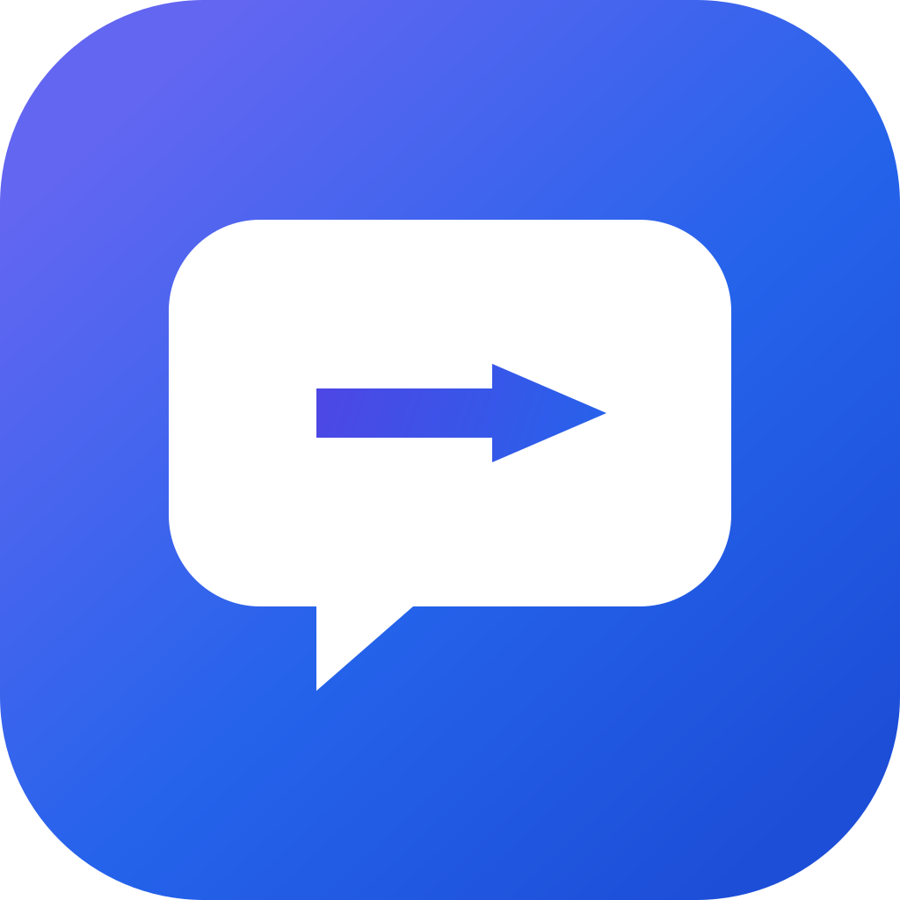

<p align="center">
  
</p>

<h1 align="center">Relais Client</h1>

<p align="center">
  Récupère les messages et images envoyés par tes clients sur ton téléphone,<br>
  extrais le texte des images et retrouve tout sur ton PC en un envoi.
</p>

<p align="center">
  
  
  
  
  
</p>

---

## Présentation

Tes clients t'envoient des captures, des photos de documents et des messages sur WhatsApp ou par SMS, mais c'est sur
ton PC que tu travailles. Relais Client rassemble tout au même endroit, lit le texte des images (OCR) et te
l'envoie par e-mail, prêt à copier-coller.

## Fonctionnalités

### 📥 Récupérer
- **Partager vers Relais Client** depuis WhatsApp, Messages, la Galerie… (plusieurs images à la fois).
- **Lecture directe des SMS et MMS** reçus, filtrés par période et par numéro, avec le nom du contact.
- Ajout depuis la galerie, l'appareil photo, le presse-papier ou en saisie libre.

### 🔍 Extraire le texte
- **OCR sur le téléphone** avec Google ML Kit : hors ligne, gratuit, rapide.
- OCR en ligne (OCR.space) en secours.
- Texte extrait modifiable et ré-extraction possible.

### 🗂️ Trier
- Filtres **par période** : 15 min, 1 h, 3 h, aujourd'hui, 24 h, 7 jours, tout ou durée perso.
- Filtre « non envoyés » et filtre par client.
- Historique « envoyé le… » et nettoyage automatique.

### 📤 Envoyer
- **Envoi par e-mail** : texte du message, texte extrait et images en pièces jointes.
- Objet personnalisable (`{client}`, `{date}`, `{nombre}`) et adresse par défaut.
- Partage vers une autre appli, export en `.txt` ou simple copie.

## Aperçu du fonctionnement

```
 WhatsApp / SMS / Galerie  ──►  Relais Client  ──►  OCR (ML Kit)  ──►  E-mail vers ton PC
```

1. Appui long sur une image ou un message → **Partager** → **Relais Client** (ou import depuis l'onglet SMS).
2. Le texte des images est extrait automatiquement.
3. Choisis la période, coche les messages, **Envoyer**.

## Stack technique

| Partie | Techno |
|---|---|
| App | Expo SDK 58, React Native 0.88, TypeScript |
| Module natif | Kotlin : lecture SMS/MMS et OCR Google ML Kit |
| Stockage | AsyncStorage (tout reste sur le téléphone) |
| Build | EAS Build (APK) |

## Installation

Installation des dépendances, test dans Expo Go, construction de l'APK avec EAS et autorisation des SMS sur
Android récent : tout est détaillé dans **[INSTALLATION.md](INSTALLATION.md)**.

## Licence

Distribué sous licence [MIT](LICENSE).
